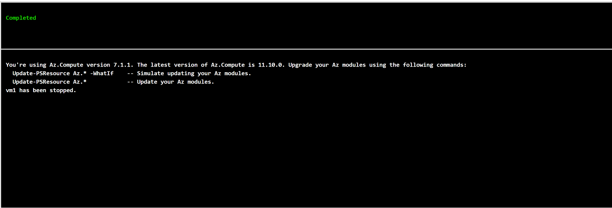
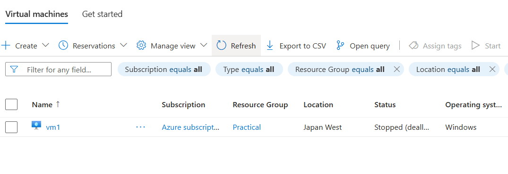

# Azure Automation – VM Shutdown

**Platform Technology school activity | October 2026**

## About this activity

For this activity, I tried using Azure Automation to stop a virtual machine. I made an Automation Account, imported a graphical runbook named `stopazvms`, and set up a one-time schedule using Philippine time.

I also connected the runbook to my test VM (`vm1`) and gave the automation account permission to manage it for the activity.

## Tools I used

- Microsoft Azure
- Azure Virtual Machines
- Azure Automation Account
- Graphical Runbook
- Azure role-based access control (RBAC)

## Output

I ran the runbook in the **Test pane**. The result showed **Completed** and the message **"vm1 has been stopped."**

I checked the Azure virtual machines list afterward, and `vm1` showed a **Stopped (deallocated)** status.

## What I learned

This activity helped me understand how Azure Automation can be used for routine tasks instead of manually managing a VM every time. I also learned that the runbook needs the correct parameters and access permissions to work.

I used the Contributor role for this classroom activity. If I do a similar project again, I would look into giving only the permissions the automation actually needs.

**Note:** I tested the runbook manually through the Test pane. I configured a schedule, but I did not separately verify a scheduled run. This was an academic activity using Azure free trial resources, and those resources have since been deleted.
